# groundrl

**A deterministic citation-grounding verifier used as a verifiable reward (RLVR), a reward-hacking
audit of it, and an unrun LoRA + GRPO pipeline for training small models to answer questions about
Ethereum EIPs with correct, grounded citations.**


## For the lay reader

- [docs/diagrams/explainer.svg](docs/diagrams/explainer.svg) &mdash; a one-page
  summary in ordinary words: the question, one chart, the finding, and why it
  matters. No background assumed.
- [GLOSSARY.md](GLOSSARY.md) &mdash; every abbreviation this repo uses, defined.
- [What does all this mean?](https://claude.ai/artifact/Mctu5EP8YgfjGx6fcCHDgs)
  &mdash; the across-the-whole-project explainer, with all six repos on one page.

> **Training results: NOT YET RUN.** No model has been trained or fine-tuned in this repository.
> It was built in a container with no GPU. Everything under "Results" below is either a scripted,
> model-free result that anyone can regenerate with one command, or an explicit placeholder.
> `scripts/make_report.py` renders only from `results/*.json` files produced by real runs, and
> says "NOT YET RUN" until one exists.

## The idea

Retrieval-augmented answers are only useful if each claim can be traced to the text it came from.
Checks for that are usually applied after the model has answered. Here the same deterministic check
is used as the *reward* during RL, so a small model (Qwen3-0.6B / 1.7B class) can be trained to cite
correctly in the first place. The verifier accepts an answer only if

1. every sentence carries a citation of the form `[eip-N#CCC]`;
2. every cited chunk was in the provided context (a citation like `[eip-1559#999]` is spoofed);
3. every number, hex value, `2**n` expression and ALL_CAPS identifier in a sentence appears as a
   token in the chunks that sentence cites.

A verifier like that is cheap, exact and reproducible, and it is also easy to game: it checks token
presence, not meaning. The contribution of this repository is therefore (1) the reward design and
its reward-hacking analysis, which is real and reproducible here, and (2) the training and
evaluation pipeline, which is complete but unrun.

## Related work

* **`groundrails`** (PyPI, MIT): per its PyPI description, "Grounding guardrails for agentic RAG -
  deterministic claim verification". It is the closest tool I found; I read only its package
  description, and nothing there describes using the check as an RL reward.
* A May 2026 write-up of RLVR with GRPO on a 1.5B code model with graded rewards motivated the
  graded reward (v1). I have not re-read it while building this repository; it is cited from the
  owner's notes.
* I found nothing on citation-grounding rewards for RL. That is the result of a limited search,
  not a proof that none exists.
* The verifier is a clean reimplementation of the grounding check in the author's own
  [`ethresearch-rag`](https://github.com/Intermountainh8ter/ethresearch-rag) (MIT, same author).

## Design



* **Corpus.** 130 curated EIPs fetched from `raw.githubusercontent.com` (CC0; ERC
  documents come from the ERCs repository), sha256 manifest in `data/MANIFEST.json`, chunked
  with a section/table/code-aware chunker (`3066` chunks).
* **Tasks.** 1792 seeded questions with gold (`1262` train / `265` val /
  `265` test), five types: constant lookup, opcode/type byte, multi-fact, comparison across two
  EIPs, and unanswerable (the gold chunk is absent; the right behaviour is a fixed abstention
  sentence). The split is **by EIP**: no EIP appears in two splits, not even as a distractor chunk.
* **Rewards.** `v0` binary verifier pass; `v1` graded per sentence; `v2` graded plus relevance,
  answer-correctness against gold, citation precision/recall, length and redundancy penalties, a
  consistency term against hedging, and abstention calibration. Pure functions returning
  `(score, breakdown)`, with TRL wrappers (`make_trl_reward`) importable without TRL.
* **Pipeline (unrun).** SFT baseline with LoRA, adapter merge, GRPO with reward v2 on a fresh
  LoRA, evaluation on TEST with bootstrap intervals. JSON configs for Qwen3-0.6B and 1.7B at 24 GB
  and 12 GB, `--dry-run` that needs no torch, and `--mock` plumbing runs labelled MOCK.
* The core library uses only the standard library and numpy; torch, transformers, trl, peft,
  datasets and vllm are optional extras imported lazily and never required by the tests.

Details and the revision history of the reward are in [`docs/METHODOLOGY.md`](docs/METHODOLOGY.md).

## Results

### 1. Reward-hacking audit (real, no model, reproducible)

Nineteen scripted policies (plain functions) are scored under each reward version on the TEST
split (265 tasks: 235 answerable, 30 unanswerable). A non-reference
policy is flagged **EXPLOITABLE** (bold) if its mean reward is at least 0.50, a threshold fixed
before any number was produced. "fires on" is the share of tasks where the policy's output
differs from the gold answer.

```
python scripts/reward_audit.py --split test     # about 30 s, writes results/audit_test.{json,md}
```

| policy | kind | uses gold | fires on | v0 | v1 | v2 | v2 when fired |
|---|---|---|---|---|---|---|---|
| `oracle` | reference | yes | 0% | 0.887 | 0.887 | 1.000 | n/a |
| `extractive` | reference | no | 57% | 0.985 | 0.988 | 0.613 | 0.325 |
| `eip_id_shortcut` | reference | no | 52% | 0.928 | 0.931 | 0.670 | 0.361 |
| `copy_chunk` | hack | yes | 97% | **0.981** | **0.996** | 0.185 | 0.160 |
| `cite_everything` | hack | yes | 100% | **1.000** | **1.000** | 0.296 | 0.296 |
| `stuff_numbers` | hack | yes | 100% | **1.000** | **0.882** | 0.247 | 0.247 |
| `refuse_all` | hack | no | 89% | 0.000 | 0.000 | 0.113 | 0.000 |
| `parrot_question` | hack | no | 100% | 0.174 | **0.500** | 0.077 | 0.077 |
| `empty` | hack | no | 100% | 0.000 | 0.000 | 0.000 | 0.000 |
| `citation_spam` | hack | yes | 100% | **1.000** | **1.000** | 0.000 | 0.000 |
| `wrong_chunk` | hack | no | 100% | **0.887** | **0.928** | 0.074 | 0.074 |
| `one_wrong_constant` | hack | yes | 88% | **0.989** | **0.996** | 0.277 | 0.181 |
| `paraphrase_no_tokens` | hack | no | 100% | **1.000** | **0.724** | 0.064 | 0.064 |
| `hedge_right_and_wrong` | extra | yes | 78% | **0.989** | **0.998** | 0.276 | 0.073 |
| `hedge_inline` | extra | yes | 78% | **1.000** | **0.998** | 0.440 | 0.284 |
| `spoofed_citation` | extra | yes | 100% | 0.000 | 0.000 | 0.000 | 0.000 |
| `hallucinated_value` | extra | yes | 100% | 0.113 | **0.722** | 0.109 | 0.109 |
| `uncited_correct` | extra | yes | 100% | 0.000 | 0.000 | 0.000 | 0.000 |
| `unicode_obfuscation` | extra | yes | 100% | 0.049 | 0.049 | 0.000 | 0.000 |

What it shows, in plain terms:

* **v0 and v1 are broken as training rewards.** Seven of the ten required hacks (copy the chunk,
  cite everything, stuff numbers, repeat a citation, answer from the wrong chunk, swap one constant
  for another number from the same chunk, say something vague with a citation) score 0.89-1.00
  under v0 and 0.72-1.00 under v1. Nothing in a binary or graded verifier distinguishes them
  from a correct answer.
* **v2 (revision 2) holds every enumerated hack below 0.50 on TEST and VAL.** The highest is
  `hedge_inline` (the right value followed by "(or <wrong value>)") at 0.440.
  Revision 1 of v2 was exploitable by both hedges (0.63); the audit found that, and revision 2
  fixed it (revision log in `docs/METHODOLOGY.md`).
* **Which term closes which hole** (full table with every ablation in `results/audit_test.md`):
  removing the citation term re-opens `cite_everything` (0.89); removing correctness re-opens
  `stuff_numbers`, `one_wrong_constant` and `hallucinated_value` (0.61-0.85); abstention
  calibration is what keeps `refuse_all` at the unanswerable share (0.113).
* **A reward without gold labels is not enough.** v2 with only the verifier-based terms is
  exploitable by 7 policies on TEST (9 on VAL).
* **Residual holes, reported honestly.** `hedge_inline` reaches 0.44; `copy_chunk` still earns at
  least 0.5 on about 14% of tasks, where the gold chunk is a single short sentence and copying it
  is indistinguishable from answering; a hedge that rewords the second sentence is not caught by
  the consistency term (only by the extra-claim penalty). `v2` was revised after looking at this
  TEST audit, so "closed" is in-sample for the attacks I enumerated; VAL is a robustness check.
  A trained policy may find attacks I did not.

### 2. Scripted baselines (real, not trained models)

The same evaluation pipeline that will score a trained model, applied to scripted policies on TEST
(95% bootstrap intervals over tasks). `extractive` takes the single best-matching line and cites
it; it is the bar a trained model has to clear to show it learned more than locate-and-copy.

```
groundrl baseline-eval --split test
```

| scripted policy | grounded-correct | verified | abstain recall | hallucinated cite | v0 | v1 | v2 |
|---|---|---|---|---|---|---|---|
| `oracle` | 100.0% (100.0-100.0) | 100.0% (100.0-100.0) | 100.0% (100.0-100.0) | 0.0% (0.0-0.0) | 0.887 | 0.887 | 1.000 (1.000-1.000) |
| `extractive` | 57.4% (51.1-63.8) | 98.3% (96.6-99.6) | 0.0% (0.0-0.0) | 0.0% (0.0-0.0) | 0.985 | 0.988 | 0.613 (0.563-0.663) |
| `eip_id_shortcut` | 57.4% (51.1-63.8) | 98.3% (96.6-99.6) | 50.0% (18.2-81.5) | 0.0% (0.0-0.0) | 0.928 | 0.931 | 0.670 (0.622-0.716) |
| `refuse_all` | 0.0% (0.0-0.0) | 0.0% (0.0-0.0) | 100.0% (100.0-100.0) | 0.0% (0.0-0.0) | 0.000 | 0.000 | 0.113 (0.079-0.151) |

### 3. Training results: NOT YET RUN

| run | grounded-correct | verified | abstain precision / recall | hallucinated cite | v2 |
|---|---|---|---|---|---|
| base Qwen3-0.6B | NOT YET RUN | NOT YET RUN | NOT YET RUN | NOT YET RUN | NOT YET RUN |
| SFT baseline | NOT YET RUN | NOT YET RUN | NOT YET RUN | NOT YET RUN | NOT YET RUN |
| GRPO, reward v2 | NOT YET RUN | NOT YET RUN | NOT YET RUN | NOT YET RUN | NOT YET RUN |

These rows are placeholders, not estimates. They will be replaced by numbers only through
`python scripts/make_report.py` after `train/eval.py` has written real `results/eval_*.json` files.

## Quickstart

```bash
pip install -e ".[dev]"            # numpy only; no torch needed
pytest -q                          # whole suite, no GPU, no network
ruff check .

groundrl check-data                # manifest hashes + task invariants
python scripts/reward_audit.py --split test
groundrl baseline-eval --split test
python scripts/make_report.py      # renders results/*.json into results/REPORT.md

# the training pipeline, without a GPU:
python train/grpo.py --config train/configs/qwen3-0.6b-24gb.json --dry-run
python train/grpo.py --config train/configs/qwen3-0.6b-24gb.json --mock --limit 16   # MOCK
```

Scoring an answer yourself:

```python
from groundrl.dataset import load_dataset
from groundrl.example import make_example
from groundrl.rewards import reward_v2

ds = load_dataset("data")
ex = make_example(ds.tasks["test"][0], ds.index)
score, breakdown = reward_v2(ex.task.gold_answer, ex)      # 1.0 for the gold answer
```

Real training needs `pip install -e ".[train]"` and a GPU; see [`docs/RUNBOOK.md`](docs/RUNBOOK.md)
for Windows PowerShell and Linux instructions and rented-GPU notes.

## Repository layout

| path | what |
|---|---|
| `src/groundrl/verifier.py`, `tokens.py` | the deterministic grounding verifier and its token primitives |
| `src/groundrl/rewards.py`, `consistency.py` | reward v0/v1/v2 and TRL wrappers |
| `src/groundrl/audit.py` | the adversarial policies and the audit |
| `src/groundrl/chunker.py`, `facts.py`, `tasks.py`, `dataset.py` | chunking, fact extraction, task generation |
| `src/groundrl/trainconf.py`, `trainplan.py`, `trainctl.py`, `trl_backend.py` | configs, dry run, runners (heavy imports are lazy) |
| `src/groundrl/evaluate.py`, `report.py` | metrics with bootstrap CIs, report renderer |
| `train/` | `sft.py`, `grpo.py`, `eval.py` and `configs/*.json` |
| `data/` | raw EIPs, manifest, chunks, facts, task splits |
| `results/` | audit, baselines, report (no training results) |
| `docs/` | methodology, threats to validity, runbook, flowcharts, launch copy |

## Limits

The verifier is lexical, the questions are synthetic templates, the TEST split has 265 tasks
from a small number of EIPs, and nothing has been trained. Read
[`docs/THREATS_TO_VALIDITY.md`](docs/THREATS_TO_VALIDITY.md) before drawing any conclusion.

## License

MIT, Copyright (c) 2026 Ammon Jackson. The EIP texts in `data/raw` are CC0. The verifier is adapted
from `ethresearch-rag` (MIT, same author).
