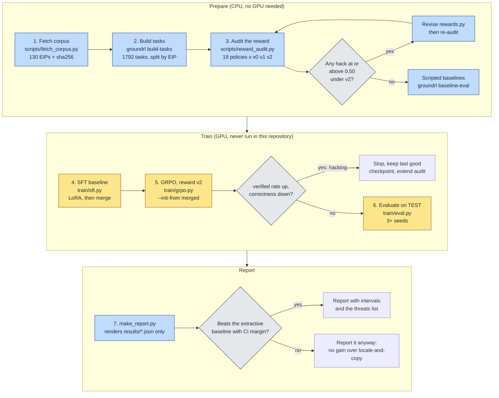
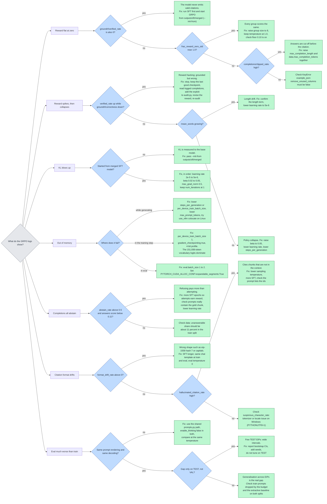

# Flowcharts

Both charts are Mermaid sources kept in `docs/diagrams/*.mmd`; the rendered SVGs next to them are
regenerated with `scripts/render_diagrams.sh` (needs node 18+ and a Chromium; set
`PUPPETEER_EXECUTABLE_PATH` to use an existing browser).

## Usage: from corpus to report

Blue nodes run on a laptop; yellow nodes need a GPU and have never been run in this repository.

## Troubleshooting: decision tree on real symptoms

Every leaf is a concrete change. The metric names are the ones TRL logs plus the `groundrl/*`
diagnostics added by the reward wrapper (`make_trl_reward`); see `docs/RUNBOOK.md` section 5.

